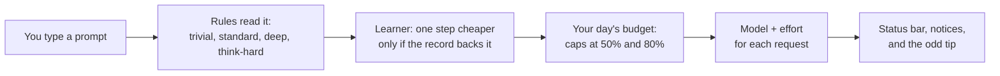

# budget-router

**Stay inside your Claude weekly limit without thinking about it.**

A community plugin for Claude Code (not made or endorsed by Anthropic). It picks the right model and effort for every prompt, turns your weekly limit into a daily budget, warns you before you run out, and teaches you the habits that make a limit last.

```
sonnet·high (standard) │ day 42% │ 5h 12% │ week 61% │ saved $3.10      ← the status bar under your prompt
```

## What you get

| | |
|---|---|
| **No surprise at the limit** | Your weekly limit is split evenly over the days left. The status bar shows today's share, a notice appears at 50% and 80%, and one wrap-up heads-up at 90%, so you finish what you are doing instead of hitting a wall mid-task. Nothing is ever refused. |
| **The right model for each prompt** | "rename this variable" does not need Opus; "redesign the save system" does. Simple prompts go to Sonnet or Haiku, hard ones to Opus, and "think hard" goes to the top. As the day fills, routes step down gracefully instead of stopping. |
| **It learns what is enough for you** | A small local learner watches which cheaper setting worked for your kind of prompt and tries it only on evidence. It is early and cautious by design: it never leaves the rule-based choice without a record behind it. |
| **It teaches cheaper habits** | A short tip appears when the situation calls for it: a long paste, a build log, a very long turn, repeated failures, a capped day. The [cheatsheet](plugins/budget-router/CHEATSHEET.md) has every habit, each checked against Claude Code's documentation. |
| **A report with conclusions** | One command turns your own transcripts into a page that shows where your usage went and what to change. See [Measure your own savings](#measure-your-own-savings). |
| **Private by construction** | Sends nothing, runs no programs, reads no files, stores no prompt text, adds nothing to your prompts. Six hooks and five short source files you can read in an afternoon, and checks in the repository that fail if any of that changes. |

## Why it matters

Most of a Claude Code session's usage is not your new words, it is the **whole conversation being re-sent with every request**. In the author's own 30 days (884 prompts), 85% of estimated usage was context being re-read or re-written, and only 15% was fresh output. Switching a model helps at the edges; shrinking the conversation and keeping long turns short helps far more. budget-router does both jobs: it routes, and it nudges you toward the habits that matter. (One person's usage; your report will say what is true for you.)

## How it works



The router is **rules first**: keywords and the shape of a prompt choose the tier (chit-chat runs on Haiku, normal coding on Sonnet, design and hard bugs on Opus, "think hard" on Opus at higher effort; the [full table](plugins/budget-router/README.md#routing) is in the reference). The learner and the budget only adjust that choice. You can pin a route with the `pin` option whenever you prefer to decide yourself. The full picture, with class, sequence and decision diagrams, is in [ARCHITECTURE.md](plugins/budget-router/ARCHITECTURE.md).

## Two plugins, one marketplace

| | **budget-router** (full) | **budget-router-lite** |
|---|---|---|
| What it is | Automatic: routes every prompt, keeps a daily budget, status bar, notices, tips, learner | Manual: one-line commands for the habits that save the most (`ask`, `quick`, `deep`, `handoff`, `pace`, `tips`) plus five helper agents |
| How it works | A hooks module (a "mod") | Plain markdown: no code, no hooks, no options, no network |
| Where to get it | This marketplace (below) | This marketplace, and the Anthropic plugin directory once it is listed |
| Pick it if | You want it automatic | You want zero code to trust, or your organization only allows directory plugins |

The Anthropic directory accepts mods only from Verified organizations, so the full router is shared from this repository, and the lite plugin is the one submitted to the directory. Both are in [`plugins/`](plugins).

## Install

Run these commands in a terminal (not inside a Claude session):

```
claude plugin marketplace add ValhalaStudio/budget-router-kit
claude plugin install budget-router@budget-router-kit        # the full router
claude plugin install budget-router-lite@budget-router-kit   # the markdown-only companion
```

Start a new session with plain `claude`. After the first reply the status bar shows your route and today's budget. A session that was already open needs a restart (or `/reload-plugins`).

**Needs** Claude Code 2.1.287 or newer and a Claude subscription (Pro or Max). On an API key routing still works, but there are no rate-limit readings, so the daily budget does not.

## Measure your own savings

We do not promise a percentage: what you save depends on how you work. The report shows yours.

```
python -I study/report.py --days 30
```

It reads your local transcripts and the plugin's store, and writes one HTML page (`study/out/report.html`) with:

- where the usage went (cache re-reads, cache writes, output) and which model took it,
- your longest turns, your pauses, and what failed tool calls cost,
- the **measured cost of each effort level** on each model, next to the learner's built-in guess,
- what the learner has found so far,
- **what to change**, as plain conclusions tied to the cheatsheet.

Everything runs on your machine; no prompt text is kept and nothing is uploaded. The plugin itself never runs it.

## Frequently asked

**Will it ever block me?** No. It never refuses or holds a prompt, a tool call or a subagent. At 100% of the day's share, turns simply stay at the second cap. Claude Code's own limits are the only hard stop.

**Does it send my prompts anywhere?** No. It makes no network request, runs no program and opens no file. It reads your typed prompt in memory to choose a route and never stores it. What it keeps is counts, costs, and a hash of the project folder, in the plugin's own store. [PRIVACY.md](plugins/budget-router/PRIVACY.md) lists all of it.

**Is the learner saving me money yet?** Early on, probably not much, and it says so: the status bar shows `saved $x` only once the saving is positive, and the report shows the true running figure, which can be negative. The learner needs about eight recorded turns on a setting before it will try it on evidence. Check the report after a few weeks.

**What if my company restricts the models I can use?** It only acts on models it recognises, prefers model ids your session has already used, and swaps within the same generation only for plain ids such as `claude-sonnet-4-5`. A dated or provider-specific id is left alone, so the request stays on the model Claude Code chose. If routing does not fit your setup, set the `pin` option, or turn the plugin off.

**Does it work in claude.ai chat, the desktop app or Cowork?** It is listed for Claude Code (the terminal and the desktop app's Code tab) and for Cowork, and the author has tested it in Claude Code only. It cannot see or change a chat in the browser.

**Can I turn parts off, or choose myself?** Yes, in `/config`: tips, the idle-cache notice, the large-context notice, pace control, escalation, the learner and the Unreal rule are each an option, and `pin` fixes the route (a tier such as `deep`, or a model with an optional effort such as `sonnet:low`). Caps still apply on top of a pin.

## How it differs from other tools

Written from the projects' public READMEs on 2026-10-18; corrections welcome as issues.

| Kind of tool | Examples | What they do | What budget-router adds |
|---|---|---|---|
| Usage gauges and status lines | claude-hud, ccusage, ccstatusline | Show how much you have used | Acts on it: picks the model and effort per turn and enforces a daily share of the weekly limit |
| Pacing hooks | claude-pacer | Status line plus a wrap-up warning near the limit | Routes and caps turns as the day fills, and learns which setting is enough for your work |
| Recommenders | FlintRelay | Suggests a model, with a shadow mode | Applies the choice (and has its own `shadow` mode for the learner) |
| Routers with a proof ledger | nobodyohm router | Routes and reports statistics | Ties routing to the real subscription limit; the learner weighs cost against a failure risk that grows as the budget shrinks |
| Proxies | ccrouter | Sit in front of the API and route requests | Runs as a plugin inside Claude Code, no proxy or API key; stores no prompt text |

What no other tool I found does: treat the weekly limit as a daily budget, and let that budget decide how cautious the model choice is. Limits to know about: it only guards Claude Code, and the daily budget needs a subscription's rate-limit readings.

## For reviewers and contributors

| Read | For |
|---|---|
| [plugins/budget-router-lite/README.md](plugins/budget-router-lite/README.md) | The markdown-only plugin submitted to the directory |
| [plugins/budget-router/README.md](plugins/budget-router/README.md) | The full router's reference: what every hook reads and changes, what it runs, sends, writes and stores |
| [plugins/budget-router/ARCHITECTURE.md](plugins/budget-router/ARCHITECTURE.md) | Architecture, types, one turn, and how a route is decided, as diagrams |
| [plugins/budget-router/PRIVACY.md](plugins/budget-router/PRIVACY.md) | The privacy policy |
| [plugins/budget-router/CHEATSHEET.md](plugins/budget-router/CHEATSHEET.md) | Using Claude with fewer tokens, with sources |
| [review.md](review.md) | Notes for the Anthropic directory review |
| [CONTRIBUTING.md](CONTRIBUTING.md), [SECURITY.md](SECURITY.md) | Reporting bugs and vulnerabilities |

## Tested with

| Component | Version |
|---|---|
| Claude Code | 2.1.316 (minimum supported 2.1.287) |
| budget-router | 0.11.1 |
| OS | Windows 11 |
| Plan | Claude subscription with 5-hour and weekly limits |
| Checks | `claude plugin validate` and `claude plugin test` in `plugins/budget-router`, `node --test checks/compliance.test.mjs`, `node checks/directory-replica.mjs` |

Not tested by the author: Cowork, macOS and Linux, API-key sessions, and plans that report per-model weekly limits (handled in code and unit-tested, never seen live). Reports of other setups are welcome.

## Update and remove

```
claude plugin marketplace update budget-router-kit
claude plugin update budget-router@budget-router-kit
```

```
claude plugin uninstall budget-router@budget-router-kit
claude plugin marketplace remove budget-router-kit
```

To also delete what it stored, remove its file in `~/.claude/plugins/store/` (the name starts with `budget-router_`).

## License

GPL-3.0-or-later. Copyright (C) 2026 ValhalaStudio. See [LICENSE](LICENSE).
