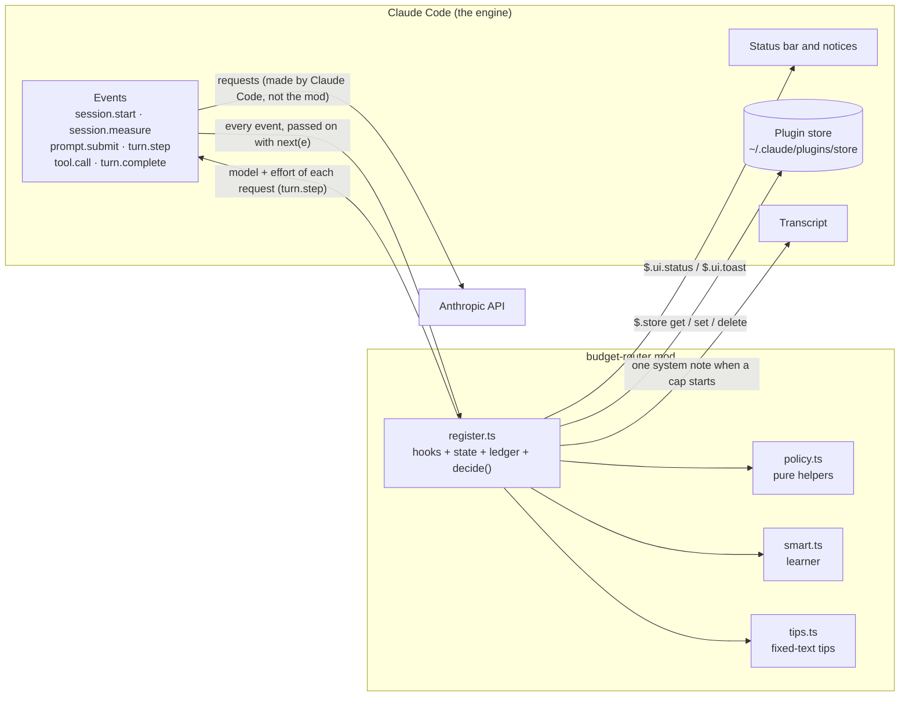
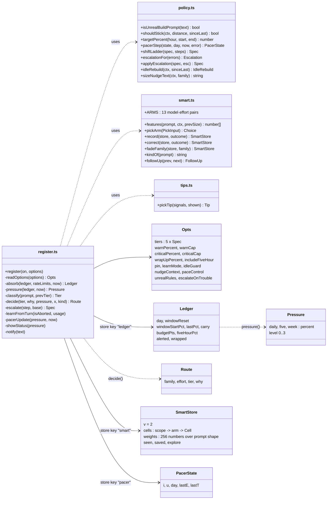
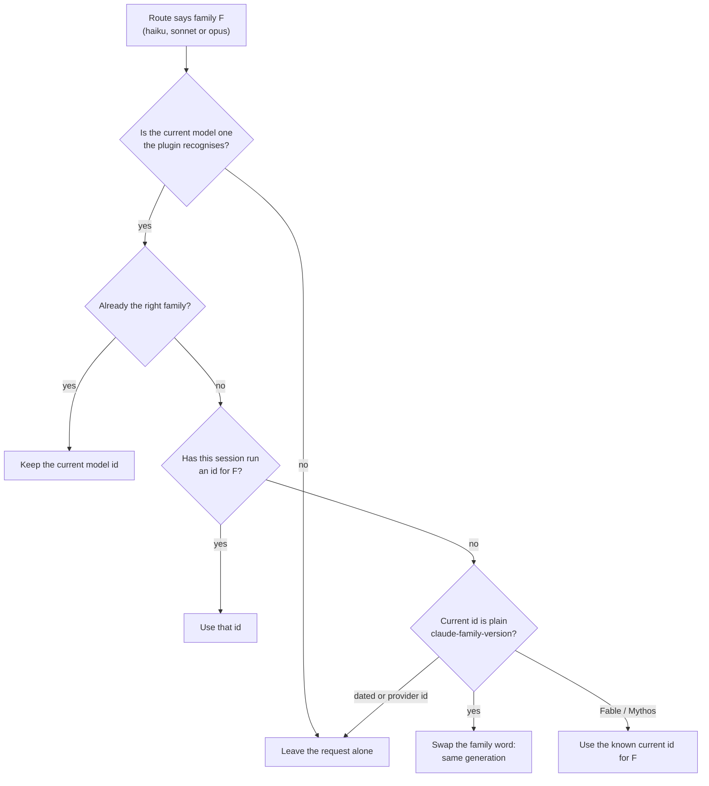
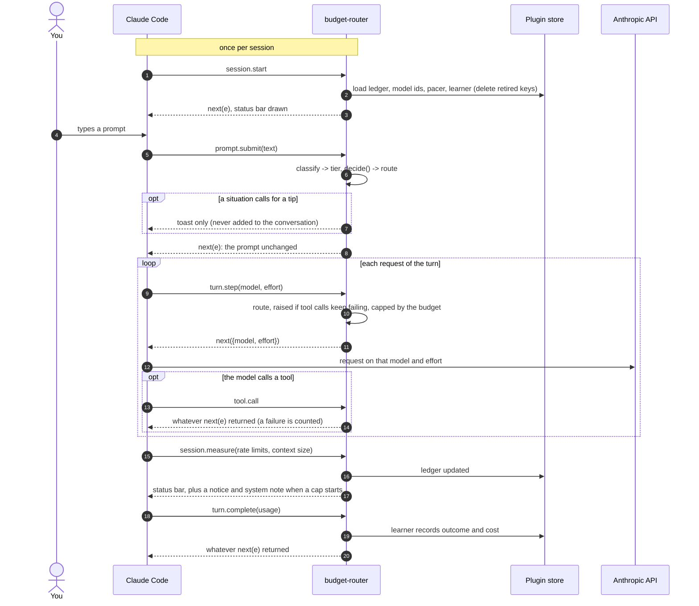
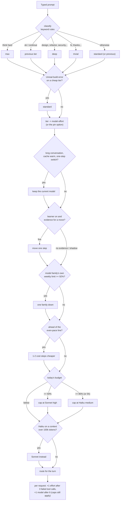
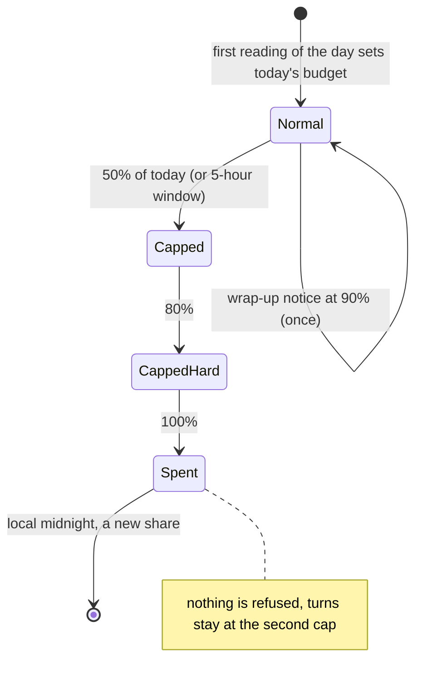

# budget-router architecture

Four source files, no dependencies. Everything runs inside Claude Code; nothing leaves the machine.

| File | Role | Engine calls |
|---|---|---|
| `hooks/register.ts` | The hooks, session state, the daily budget ledger and the route decision | `$.store`, `$.ui.status`, `$.ui.toast`, `$.session.usage`, `$.session.cwd`, `$.session.append` |
| `hooks/policy.ts` | Pure routing helpers: Unreal rule, cache-aware switching, pace controller, cost ladder, escalation, context notices | none |
| `hooks/smart.ts` | The learner: a cost-aware bandit over (model, effort) | none |
| `hooks/tips.ts` | Fixed-text tips and the rules for when to show one (the caller shows them as a toast) | none |
| `agents/*.md` | Five helper subagents Claude Code offers by their descriptions; not part of the mod | none |
| `study/report.py` (repository root) | Offline usage report with conclusions; never run by the plugin, outside the plugin folder | none (reads your transcripts when you run it) |

## Architecture

The mod makes no request of its own, runs no program, reads no file and registers no tool or command. The only thing it changes in an event is the `model` and `effort` of a request in `turn.step`.

## Modules and types

Store keys: `ledger`, `models` (full model ids seen), `pacer`, `smart`. No prompt text is stored anywhere; `SmartStore` holds counts, costs, a fixed kind label and a hash of the project folder.

## Which model id is sent

`turn.step` receives the model Claude Code chose and may change it. The mod never invents an id it cannot justify:

A dated id such as `claude-sonnet-4-5-20250929`, a provider-specific id or a company deployment name is never rewritten, because the swapped name may not exist for the other family.

## What happens in one turn

## How a route is decided

A pin skips the sticky rule, the learner, the family rule, pace control and escalation; the caps still apply.

## Budget states

